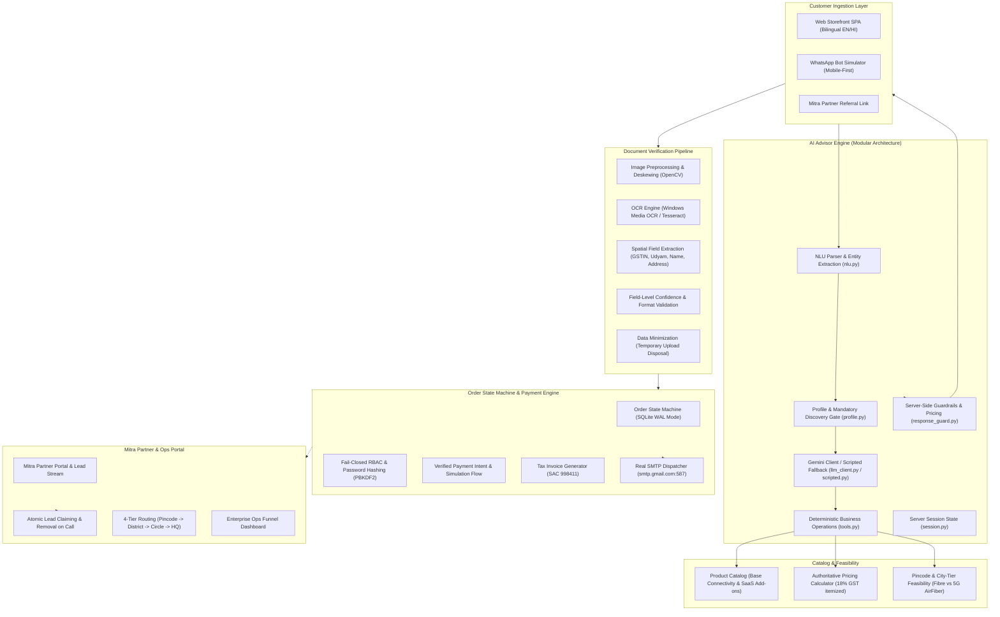

# Project Udyam Digital — Airtel Business Onboarding Prototype

> **Airtel SYNC Hackathon 2026 — Enterprise Track A: MSME Digital Self-Serve Acquisition & Onboarding**  
> *A working reference prototype demonstrating digital self-serve onboarding, conversational AI discovery, smart document verification, and channel partner harmony for Indian MSMEs.*

---

## 📌 Project Overview & Scope

**Project Udyam Digital** is an end-to-end working prototype developed as a proof-of-concept for the Airtel SYNC Hackathon. It addresses the operational bottlenecks of traditional enterprise telco onboarding—manual discovery, slow document turnaround, paper-heavy KYC verification, and channel friction between direct digital channels and local field partners (Airtel Mitras).

> [!NOTE]
> **Prototype Grounding & Current State**:  
> This codebase is an **advanced prototype and reference implementation**, not a production-hardened commercial system. While all primary user flows—conversational advisory, catalog pricing, document parsing, order state transitions, receipt generation, and email dispatch—are functional and test-verified, it utilizes local/mock integrations for external dependencies (e.g., SQLite for persistence, simulated registry lookups, and test payment flows) in place of enterprise telco backend infrastructure.

### Key Objectives
* **Accelerate Discovery to Staging**: Enable micro and small enterprises to configure eligible connectivity and SaaS bundles in minutes through natural conversation.
* **Dual-Track KYC Verification**: Support both formal GST-registered businesses and informal proprietorships operating via Udyam Registration.
* **Deterministic Server-Side Control**: Use LLMs (Google Gemini) strictly for natural language understanding and dialogue orchestration, while keeping all pricing calculations, plan eligibility, statutory constraints, and cart state deterministic and backend-enforced.
* **Channel Harmony**: Preserve and empower the local partner network (Airtel Mitra) with a dedicated portal, localized lead routing, atomic lead claiming, and transparent commissions.

---

## 🏛️ System Architecture



---

## ⚙️ Core Modules & Functional Implementation

### 1. Conversational AI Advisor (Refactored Modular Architecture)
The advisor is structured into dedicated single-responsibility modules under `app/modules/advisor/`:
* **`nlu.py`**: Intent recognition (discovery, recommendation, downsell, remove add-on, inquiry, escalation) and multilingual entity extraction (cities, pincodes, business types, site counts, employee scale, GST status).
* **`profile.py`**: Non-destructive profile state merging, location synchronization (city $\leftrightarrow$ benchmark pincode $\leftrightarrow$ city tier), and mandatory discovery gating.
* **`tools.py`**: Deterministic business operations for bundle generation, progressive down-selling, add-on removal, quote computation, and human escalation.
* **`llm_client.py`**: Google Gemini integration using structured response contracts and contextual system instructions.
* **`scripted.py`**: Full rule-based deterministic fallback ensuring seamless operation when Gemini is unreachable.
* **`response_guard.py`**: Output validation layer that audits product eligibility, dependency compliance, enforces base connectivity, strips removed add-ons, and calculates authoritative pricing.
* **`service.py`**: Central orchestrator coordinating session ownership, NLU, LLM invocation, deterministic execution, and state persistence.

#### Key Advisor Behaviors
* **Mandatory Location Discovery**: Recommendations are gated until both **Location** (city or 6-digit pincode) and **Employee Scale** are provided. The advisor dynamically determines city tier (Tier 1 Metro, Tier 2, Tier 3) and checks fiber vs 5G AirFiber feasibility upfront.
* **Synchronized Cart & Add-on Removal**: Customer requests to remove discretionary items (e.g., *"remove endpoint security"*) or downsell (*"sasta plan"*) synchronously update the backend bundle, chat explanation, and frontend drawer in real-time.
* **Bilingual Support**: Instant switching between English and Hindi across chat and storefront.

### 2. Smart KYC & Document Verification Engine
* **Preprocessing & Quality Gate**: Grayscale conversion, contrast adjustment, and OpenCV Laplacian variance blur checks to identify unreadable images before processing.
* **Dual-Engine Support**: Native Windows Media OCR (`winocr`) with fallback to Tesseract (`pytesseract`), supporting configurable cross-platform execution.
* **Spatial & Targeted Field Extraction**: Pattern matching and bounding-box validation for GSTIN, Udyam Registration Number, legal entity name, trade name, address, and pincode.
* **Field-Level Confidence**: Tracks confidence at the individual field level rather than relying solely on page-level averages. Critical fields failing confidence checks trigger targeted manual review flags.
* **DPDP Act 2023 Compliance**: Uploaded document binaries are processed in-memory or temporary storage and deleted post-verification, keeping only validated metadata.

### 3. Order State Machine, Authoritative Pricing & Security Controls
* **Catalogue as Single Source of Truth**: `product_catalogue.csv` is the authoritative truth for commercial terms, pricing floors/ceilings, city tier restrictions, site counts, minimum contract durations, dependencies, and statutory GST requirements.
* **Server-Authoritative Pricing & Anti-Tamper Protection**: All quotes and orders are recalculate server-side via `validate_and_price_order()`. Frontend-submitted prices, unauthorized discount codes, and fabricated setup fee waivers are detected and strictly rejected.
* **Clear Separation of Simulated vs. Real Operations**: Prototype simulations (network feasibility heuristics, test payment tokens, estimated installation schedules) are explicitly labeled as `DEMO / SIMULATED` across UI badges and API responses (`is_simulated: True`, `mode: "DEMO_SIMULATED"`). Fabricated field engineer commitments have been replaced with simulated dispatch notices.
* **Server-Controlled KYC Verdict**: Orders cannot transition to payment or fulfillment without a server-validated KYC record with an approved verdict.
* **Verified Payment Intents**: Client-side claims of payment success are rejected. Transactions require server-side intent verification with configurable booking token amounts (`₹499`).
* **Explicit Customer Consent**: Customer consent is not assumed; consent timestamp, purpose, and version are explicitly recorded upon affirmative user action under the DPDP Act 2023.
* **Ownership Enforcement**: Read and write access to orders, KYC cases, and receipts is strictly scoped to the authenticated user ID or authorized administrative roles.
* **Hardened Authentication**: Passwords hashed with individual cryptographic salts via PBKDF2-HMAC-SHA256. Public role-switch backdoors and universal passwords have been removed; auth APIs fail closed.

### 4. Mitra Partner Ecosystem & Channel Harmony
* **Lead Stream Filtering**: Converted leads (where the booking token is already paid or installation is dispatched) are automatically excluded from the Mitra marketplace.
* **Atomic Lead Claiming & Call Handling**: When a partner dials or claims a lead, the lead is atomically removed from the open pool to prevent duplicate outreach.
* **Hierarchical Routing Engine**:
  * Level 1: Exact 6-Digit PIN Match $\rightarrow$ Local Retail Store.
  * Level 2: 3-Digit Postal Prefix $\rightarrow$ District Mitra Hub.
  * Level 3: City / Circle Regional Pool.
  * Level 4: Central Enterprise Operations Desk (National HQ).

### 5. Multi-Channel Simulation & Real Notifications
* **Storefront SPA**: Modern web portal with real-time quote preview, multi-item breakdown, and bilingual support.
* **WhatsApp Web Simulator**: Mobile-first simulation (`/whatsapp_simulator.html`) sharing the same underlying advisor state, profile engine, and catalog rules.
* **Real SMTP Notifications**: Connected via Google Workspace SMTP (`smtp.gmail.com:587`, STARTTLS) to dispatch real booking confirmations, B2B tax receipts, and installation schedules directly to customer email addresses.

### 6. Regional Language Support & Localization Architecture
* **Marathi (`mr`) Language Integration**: Added authentic, professionally verified Marathi translations alongside English and Hindi across the entire experience—Advisor conversation, product catalogue, quote breakdown, checkout, KYC guidelines, error notifications, and order tracker.
* **Extensible Localization Registry**: Centralized translation dictionaries in [`app/static/locales.js`](file:///c:/Users/HP/Desktop/Airtel/app/static/locales.js) with a modular `registerLocale(langCode, dictionary)` API, engineered for rapid onboarding of Gujarati (`gu`), Tamil (`ta`), Telugu (`te`), Bengali (`bn`), Punjabi (`pa`), Kannada (`kn`), and Malayalam (`ml`).
* **Safe Human Translations for Commercial & Statutory Terms**: Statutory pricing, GST disclosures, and DPDP 2023 legal consent forms utilize verified human-crafted copy rather than unvalidated generative translations.
* **Cross-Session Language Persistence**: The selected language is persisted in local storage (`udyam_language`) and automatically synchronized with the server-side advisor session.

### 7. Micro-Business & Non-GST Onboarding Journey
* **Dedicated Onboarding Track**: Built a streamlined, self-serve flow designed specifically for Kirana stores, pharmacies, salons, and informal micro-enterprises.
* **Interactive 3-Step Guidance Walkthrough**: Prominently guides non-technical merchants:
  1. *Ask AI Assistant*: Consult the advisor in plain natural language (voice/text) for tailored bundles without tech jargon.
  2. *Upload Business / Identity Proof*: Clear instructions on uploading PAN, Udyam Registration, or local trade licenses (no GSTIN required).
  3. *Same-Day Dispatch & Activation*: Visual milestone tracker illustrating rapid SIM/Router dispatch within 24–48 hours.
* **Non-GST Safe Mode**: One-click activation auto-filters the catalogue to zero-GST requirement products (e.g., Biz Fibre 100, Biz 5G AirFiber), eliminating frustrating compliance blockers.
* **Mobile-First Experience**: Touch-friendly fast-action chips, clean high-contrast input cards, and responsive navigation tailored for mobile-first shopkeepers.

### 8. Data-Driven Enterprise Admin & Partner Dashboards
* **Zero Hardcoded Metrics**: All analytical telemetry on both the National Ops Dashboard (`/api/admin/metrics`) and Mitra Partner Portal (`/api/partner/metrics`) is computed dynamically from real database records (`customer_leads`, `orders`, `kyc_cases`, `support_tickets`, `customer_feedback`).
* **Multi-Dimensional Analytical Filtering**: Real-time filtering across Date Ranges (Today, Last 7 Days, Last 30 Days, Custom), Business Segments (Retail, Healthcare, Tech, Hospitality), City/Circles, and Funnel Stages.
* **Partner Isolation & Authorized Scoping**: Mitra partners only view metrics and lead streams strictly assigned to their territory or attribution ID, preventing cross-tenant data leakage.
* **Authorized CSV Report Export**: Administrators can download complete lead funnel and operational telemetry as a structured CSV via `GET /api/admin/reports/export.csv`.

### 9. Post-Activation Customer Retention Hub & Support Ticketing
* **Dedicated Customer Portal View**: Customers can manage active connectivity plans, subscribed SaaS add-ons, monthly billing commitments, and historical tax receipts from `#customerDashboardView`.
* **Self-Serve Priority Ticketing Engine**: Ingests support tickets (`/api/support/tickets`) categorized under `CONNECTIVITY`, `BILLING`, `INSTALLATION`, or `EQUIPMENT`.
* **Ticket Milestone Lifecycle**: Tracks full ticket progress from `OPEN` $\rightarrow$ `IN_PROGRESS` $\rightarrow$ `RESOLVED` with diagnostic milestone timelines.
* **Post-Activation CSAT & Proactive Retention Queue**: Collects 1–5 star customer satisfaction ratings with feedback text (`/api/support/feedback`). Unfavorable ratings ($\le 3$ stars) automatically trigger an alert and flag the customer into the **Dissatisfied Customers Outreach Queue** on the Admin Ops Console for proactive executive intervention.
* **Strict Metric Separation**: Retention indicators (CSAT average, open ticket count, churn risk %) are strictly partitioned from acquisition funnel metrics.

---

## 🛠️ Technology Stack

| Layer | Component | Notes / Purpose |
| :--- | :--- | :--- |
| **Backend** | Python 3.11+, FastAPI, Starlette | Async REST API, modular service architecture |
| **Server** | Uvicorn (ASGI) | Local web server running on port 8000 |
| **Persistence** | SQLite3 (WAL Mode) | Local persistence with WAL journal mode and 30s busy timeout |
| **Conversational AI** | Google Gemini Flash API (`google-genai`) | Natural language understanding with rule-based fallback |
| **Computer Vision / OCR** | OpenCV, WinOCR, Tesseract, TheFuzz | Image quality check, deskewing, text extraction, fuzzy matching |
| **Email Dispatch** | Python `smtplib`, Google Workspace SMTP | Real email delivery for tax receipts and scheduling |
| **Frontend** | Vanilla JavaScript (ES6+), Tailwind CSS | Lightweight SPA without heavyweight framework overhead |
| **Authentication** | PBKDF2-HMAC-SHA256, OAuth2 Bearer Tokens | Individual salted credentials, role-based access control |

---

## ⚡ Setup & Execution Guide

### 1. Prerequisites
* Python 3.10+ installed on Windows (for native WinOCR) or Linux/macOS with Tesseract OCR installed.
* An optional Google Gemini API key (the system operates fully on rule-based fallbacks if omitted).
* An optional Gmail/Workspace App Password for live email dispatch.

### 2. Installation
```powershell
# Clone the repository
git clone https://github.com/vipulMadan31/Airtel-Hackathon.git
cd Airtel-Hackathon

# Install dependencies
pip install -r requirements.txt
```

### 3. Environment Setup
Create a `.env` file in the project root:
```ini
# Generative AI (Optional: falls back to deterministic rule engine if absent)
GEMINI_API_KEY=your_gemini_api_key

# Email Dispatcher (Optional: logs to local storage if absent)
SMTP_HOST=smtp.gmail.com
SMTP_PORT=587
SMTP_USER=your_email@domain.com
SMTP_FROM=Airtel Business Enterprise <your_email@domain.com>
SMTP_PASSWORD=your_16_digit_app_password
```

### 4. Running the Server
```powershell
python -m uvicorn app.main:app --host 0.0.0.0 --port 8000
```
Open your browser to `http://localhost:8000` for the Storefront, or `http://localhost:8000/whatsapp_simulator.html` for the WhatsApp flow.

### 5. Seeded Test Credentials

The prototype is pre-seeded with individual credentials for local testing across user roles:

| Role | Email | Password | Access Portal |
| :--- | :--- | :--- | :--- |
| **Enterprise Ops Admin** | `admin@airtel.com` | `airteladmin` | Click Admin tab &rarr; Log in &rarr; National Ops Dashboard |
| **Airtel Mitra Partner** | `mitra@airtel.com` | `airtelmitra` | Click Mitra tab &rarr; Log in &rarr; Partner Portal & Lead Stream |
| **MSME Customer** | `customer@business.in` | `customer123` | Click Customer tab &rarr; Sign In |

*(Public registration via `POST /api/auth/register` creates `MERCHANT` customer accounts only. Privileged `PARTNER` and `ADMIN` accounts are restricted and can only be provisioned by an authenticated administrator via `POST /api/auth/admin/create-user`).*

---

## 🧪 Test Suites & Verification

Run the entire automated test suite with a single unified command:

```powershell
# Run the complete test suite (22/22 tests passing)
pytest tests/ -v
```

Or execute individual test suites:

## 📜 Documentation, Compliance & Reports

Authoritative design specifications, audit logs, and compliance blueprints are available in the [`docs/`](docs/) directory:

* **[Privacy & Security Note (DPDP Act 2023 Compliance)](docs/PRIVACY_AND_SECURITY_NOTE.md)**: Full statutory data map, consent architecture (§§ 5–6), ephemeral document shredding pipeline (`dest_path.unlink()`), PII scrubbing, fail-closed RBAC, and prototype vs. enterprise production gap analysis.
* **[Admin Operations & Benchmark Telemetry Report](docs/ADMIN_OPS_BENCHMARK_REPORT.md)**: 2-pillar operational matrix comparing the Synthetic Historical Baseline (`smb_leads.csv`, 5,000 inquiries, 7.36% conv, 17.6d TTA, ₹15,053 CAC) against Proposed Targets (TTA $\le$ 7 days, CAC $\le$ ₹4,000, conv 12–15%) with 4-segment conversion and churn telemetry.
* **[End-to-End Merchant Lifecycle Test Report](docs/E2E_MERCHANT_LIFECYCLE_TEST_REPORT.md)**: 11-step verification trace covering merchant registration $\rightarrow$ AI discovery $\rightarrow$ authoritative quoting $\rightarrow$ DPDP affirmative consent $\rightarrow$ KYC $\rightarrow$ simulated token checkout $\rightarrow$ order tracking $\rightarrow$ support ticket $\rightarrow$ CSAT retention outreach.
* **[P0 Security & Core Architecture Report](docs/P0_IMPROVEMENTS_REPORT.md)**: Details on fail-closed authentication, strict merchant/partner isolation, authoritative server-side pricing, and simulation labeling.
* **[P1 Experience & Retention Report](docs/P1_IMPROVEMENTS_REPORT.md)**: Documentation on Marathi localization, non-GST micro-business onboarding, data-driven dashboards, and post-activation ticketing.

---

## 🧪 Automated Testing & Verification Suite

The repository includes a comprehensive 26-test automated regression suite covering all P0 security boundaries, KYC integrity, authoritative pricing, and P1 retention flows:

```powershell
# Run the complete test suite (26 passing tests)
pytest tests/ -v
```

Or execute individual test suites:

```powershell
# 1. Complete End-to-End 11-Step Merchant Lifecycle & Dissatisfied CSAT Desk
pytest tests/test_e2e_merchant_lifecycle.py -v

# 2. P1 Experience, Retention, Marathi Localization & Data-Driven Dashboards
pytest tests/test_p1_features.py -v

# 3. Authoritative Catalogue Eligibility, Anti-Tamper Pricing & Simulation Transparency
pytest tests/test_authoritative_pricing_and_simulation.py -v

# 4. P0 Security, RBAC, Partner Isolation & Secure KYC Workflow
pytest tests/test_p0_security_and_kyc.py -v

# 5. Enterprise Security Hardening & Fail-Closed RBAC Audit
pytest tests/test_security_audit.py -v

# 6. Multi-Scenario AI Advisor Comprehensive Verification
pytest tests/test_advisor_scenarios.py -v

# 7. Ownership, Server KYC, Payment Intent & DPDP Consent Audit
pytest tests/test_ownership_and_integrity.py -v

# 8. Post-KYC Payment & SMTP Tax Receipt Email Dispatch Test
pytest tests/test_email_quote.py -v
```

---

## 🔍 Honest Evaluation: Prototype vs. Production Gap Analysis

To provide an honest and grounded engineering assessment, the table below highlights where this prototype stands today versus the architectural requirements for an enterprise-scale telco deployment:

| System Layer | Current Prototype State | Production Requirements for Scale |
| :--- | :--- | :--- |
| **Data Persistence** | Local SQLite database using Write-Ahead Logging (WAL) and 30-second busy timeout. | Distributed PostgreSQL or Amazon Aurora cluster with read replicas, multi-AZ failover, and connection pooling (PgBouncer). |
| **Session Management** | In-memory session store with mutex locking. | Distributed cache (Redis / Valkey) with cluster replication and TTL-backed session persistence. |
| **Payment Gateway** | Server-side simulated payment intent verification generating mock ₹499 transaction tokens. | Certified integration with live payment aggregators (e.g., Razorpay, Cashfree, Pine Labs) using webhook signature verification and dual-entry reconciliation. |
| **Government Registry Lookups** | Simulated GSTIN and Udyam database validation with format & checksum checks. | Direct integration with GSTN APIs, MCA 21, and Ministry of MSME Udyam verification gateways via authorized GSP (GST Suvidha Provider) channels. |
| **Network Feasibility** | Pincode prefix table and sample database covering benchmark metro and non-metro cities. | Real-time GIS integration with Airtel's physical fiber OSS/BSS, FTTH splitter capacity engines, and 5G AirFiber radio coverage maps. |
| **OCR Pipeline** | Dual-engine (WinOCR / Tesseract) with OpenCV preprocessing and regex extraction. | Distributed asynchronous OCR workers (Celery/RabbitMQ) with high-accuracy document AI models (e.g., Google Cloud Document AI, AWS Textract) running on GPU nodes. |
| **Authentication & Tokens** | PBKDF2 password hashes with local bearer tokens and role-based checks. | Enterprise SSO (OAuth2 / OIDC / SAML), hardware security module (HSM) key management, short-lived JWTs with refresh token rotation, and multi-factor authentication (MFA). |
| **Email / SMS Notifications** | Single-threaded SMTP integration with Google Workspace for demo delivery. | Enterprise transactional communication gateways (AWS SES, SendGrid, Sinch, or Airtel IQ) with bounce handling, rate-limiting, and DLT-registered SMS/WhatsApp templates. |

---

## 👥 Acknowledgments

Developed as a reference architecture and working prototype for **Airtel SYNC Hackathon 2026** (Enterprise Track A: MSME Digital Self-Serve Acquisition & Onboarding).