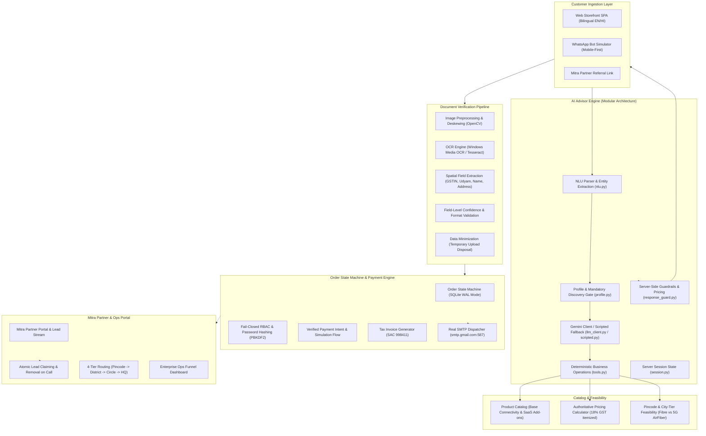

# Project Udyam Digital — Airtel Business Onboarding Prototype

> **Airtel SYNC Hackathon 2026 — Enterprise Track A: MSME Digital Self-Serve Acquisition & Onboarding**  
> *A working reference prototype demonstrating digital self-serve onboarding, conversational AI discovery, smart document verification, and channel partner harmony for Indian MSMEs.*

---

## 📌 Project Overview & Scope

**Project Udyam Digital** is an end-to-end working prototype developed as a proof-of-concept for the Airtel SYNC Hackathon. It addresses the operational bottlenecks of traditional enterprise telco onboarding—manual discovery, slow document turnaround, paper-heavy KYC verification, and channel friction between direct digital channels and local field partners (Airtel Mitras).

> [!NOTE]
> **Prototype Grounding & Current State**:  
> This codebase is an **advanced prototype and reference implementation**, not a production-hardened commercial system. While all primary user flows—conversational advisory, catalog pricing, document parsing, order state transitions, receipt generation, and email dispatch—are functional and test-verified, it utilizes local/mock integrations for external dependencies (e.g., SQLite for persistence, simulated registry lookups, and test payment flows) in place of enterprise telco backend infrastructure.

### Key Objectives
* **Accelerate Discovery to Staging**: Enable micro and small enterprises to configure eligible connectivity and SaaS bundles in minutes through natural conversation.
* **Dual-Track KYC Verification**: Support both formal GST-registered businesses and informal proprietorships operating via Udyam Registration.
* **Deterministic Server-Side Control**: Use LLMs (Google Gemini) strictly for natural language understanding and dialogue orchestration, while keeping all pricing calculations, plan eligibility, statutory constraints, and cart state deterministic and backend-enforced.
* **Channel Harmony**: Preserve and empower the local partner network (Airtel Mitra) with a dedicated portal, localized lead routing, atomic lead claiming, and transparent commissions.

---

## 🏛️ System Architecture



---

## ⚙️ Core Modules & Functional Implementation

### 1. Conversational AI Advisor (Refactored Modular Architecture)
The advisor is structured into dedicated single-responsibility modules under `app/modules/advisor/`:
* **`nlu.py`**: Intent recognition (discovery, recommendation, downsell, remove add-on, inquiry, escalation) and multilingual entity extraction (cities, pincodes, business types, site counts, employee scale, GST status).
* **`profile.py`**: Non-destructive profile state merging, location synchronization (city $\leftrightarrow$ benchmark pincode $\leftrightarrow$ city tier), and mandatory discovery gating.
* **`tools.py`**: Deterministic business operations for bundle generation, progressive down-selling, add-on removal, quote computation, and human escalation.
* **`llm_client.py`**: Google Gemini integration using structured response contracts and contextual system instructions.
* **`scripted.py`**: Full rule-based deterministic fallback ensuring seamless operation when Gemini is unreachable.
* **`response_guard.py`**: Output validation layer that audits product eligibility, dependency compliance, enforces base connectivity, strips removed add-ons, and calculates authoritative pricing.
* **`service.py`**: Central orchestrator coordinating session ownership, NLU, LLM invocation, deterministic execution, and state persistence.

#### Key Advisor Behaviors
* **Mandatory Location Discovery**: Recommendations are gated until both **Location** (city or 6-digit pincode) and **Employee Scale** are provided. The advisor dynamically determines city tier (Tier 1 Metro, Tier 2, Tier 3) and checks fiber vs 5G AirFiber feasibility upfront.
* **Synchronized Cart & Add-on Removal**: Customer requests to remove discretionary items (e.g., *"remove endpoint security"*) or downsell (*"sasta plan"*) synchronously update the backend bundle, chat explanation, and frontend drawer in real-time.
* **Bilingual Support**: Instant switching between English and Hindi across chat and storefront.

### 2. Smart KYC & Document Verification Engine
* **Preprocessing & Quality Gate**: Grayscale conversion, contrast adjustment, and OpenCV Laplacian variance blur checks to identify unreadable images before processing.
* **Dual-Engine Support**: Native Windows Media OCR (`winocr`) with fallback to Tesseract (`pytesseract`), supporting configurable cross-platform execution.
* **Spatial & Targeted Field Extraction**: Pattern matching and bounding-box validation for GSTIN, Udyam Registration Number, legal entity name, trade name, address, and pincode.
* **Field-Level Confidence**: Tracks confidence at the individual field level rather than relying solely on page-level averages. Critical fields failing confidence checks trigger targeted manual review flags.
* **DPDP Act 2023 Compliance**: Uploaded document binaries are processed in-memory or temporary storage and deleted post-verification, keeping only validated metadata.

### 3. Order State Machine & Security Controls
* **Server-Controlled KYC Verdict**: Orders cannot transition to payment or fulfillment without a server-validated KYC record with an approved verdict.
* **Verified Payment Intents**: Client-side claims of payment success are rejected. Transactions require server-side verification and deterministic token generation (`₹499` booking token).
* **Explicit Customer Consent**: Customer consent is not assumed; consent timestamp, purpose, and version are explicitly recorded upon affirmative user action.
* **Ownership Enforcement**: Read and write access to orders, KYC cases, and receipts is strictly scoped to the authenticated user ID or authorized administrative roles.
* **Hardened Authentication**: Passwords hashed with individual cryptographic salts via PBKDF2-HMAC-SHA256. Public role-switch backdoors and universal passwords have been removed; auth APIs fail closed.

### 4. Mitra Partner Ecosystem & Channel Harmony
* **Lead Stream Filtering**: Converted leads (where the booking token is already paid or installation is dispatched) are automatically excluded from the Mitra marketplace.
* **Atomic Lead Claiming & Call Handling**: When a partner dials or claims a lead, the lead is atomically removed from the open pool to prevent duplicate outreach.
* **Hierarchical Routing Engine**:
  * Level 1: Exact 6-Digit PIN Match $\rightarrow$ Local Retail Store.
  * Level 2: 3-Digit Postal Prefix $\rightarrow$ District Mitra Hub.
  * Level 3: City / Circle Regional Pool.
  * Level 4: Central Enterprise Operations Desk (National HQ).

### 5. Multi-Channel Simulation & Real Notifications
* **Storefront SPA**: Modern web portal with real-time quote preview, multi-item breakdown, and bilingual support.
* **WhatsApp Web Simulator**: Mobile-first simulation (`/whatsapp_simulator.html`) sharing the same underlying advisor state, profile engine, and catalog rules.
* **Real SMTP Notifications**: Connected via Google Workspace SMTP (`smtp.gmail.com:587`, STARTTLS) to dispatch real booking confirmations, B2B tax receipts, and installation schedules directly to customer email addresses.

---

## 🛠️ Technology Stack

| Layer | Component | Notes / Purpose |
| :--- | :--- | :--- |
| **Backend** | Python 3.11+, FastAPI, Starlette | Async REST API, modular service architecture |
| **Server** | Uvicorn (ASGI) | Local web server running on port 8000 |
| **Persistence** | SQLite3 (WAL Mode) | Local persistence with WAL journal mode and 30s busy timeout |
| **Conversational AI** | Google Gemini Flash API (`google-genai`) | Natural language understanding with rule-based fallback |
| **Computer Vision / OCR** | OpenCV, WinOCR, Tesseract, TheFuzz | Image quality check, deskewing, text extraction, fuzzy matching |
| **Email Dispatch** | Python `smtplib`, Google Workspace SMTP | Real email delivery for tax receipts and scheduling |
| **Frontend** | Vanilla JavaScript (ES6+), Tailwind CSS | Lightweight SPA without heavyweight framework overhead |
| **Authentication** | PBKDF2-HMAC-SHA256, OAuth2 Bearer Tokens | Individual salted credentials, role-based access control |

---

## ⚡ Setup & Execution Guide

### 1. Prerequisites
* Python 3.10+ installed on Windows (for native WinOCR) or Linux/macOS with Tesseract OCR installed.
* An optional Google Gemini API key (the system operates fully on rule-based fallbacks if omitted).
* An optional Gmail/Workspace App Password for live email dispatch.

### 2. Installation
```powershell
# Clone the repository
git clone https://github.com/vipulMadan31/Airtel-Hackathon.git
cd Airtel-Hackathon

# Install dependencies
pip install -r requirements.txt
```

### 3. Environment Setup
Create a `.env` file in the project root:
```ini
# Generative AI (Optional: falls back to deterministic rule engine if absent)
GEMINI_API_KEY=your_gemini_api_key

# Email Dispatcher (Optional: logs to local storage if absent)
SMTP_HOST=smtp.gmail.com
SMTP_PORT=587
SMTP_USER=your_email@domain.com
SMTP_FROM=Airtel Business Enterprise <your_email@domain.com>
SMTP_PASSWORD=your_16_digit_app_password
```

### 4. Running the Server
```powershell
python -m uvicorn app.main:app --host 0.0.0.0 --port 8000
```
Open your browser to `http://localhost:8000` for the Storefront, or `http://localhost:8000/whatsapp_simulator.html` for the WhatsApp flow.

### 5. Seeded Test Credentials

The prototype is pre-seeded with individual credentials for testing the different user roles:

| Role | Email | Password | Access Portal |
| :--- | :--- | :--- | :--- |
| **Enterprise Ops Admin** | `admin@airtel.com` | `airteladmin` | Click Admin tab &rarr; Log in &rarr; National Ops Dashboard |
| **Airtel Mitra Partner** | `mitra@airtel.com` | `airtelmitra` | Click Mitra tab &rarr; Log in &rarr; Partner Portal & Lead Stream |
| **MSME Customer** | `customer@business.in` | `customer123` | Click Customer tab &rarr; Sign In |

*(New user accounts can be registered via `POST /api/auth/register`).*

---

## 🧪 Test Suites & Verification

The repository contains automated test suites verifying critical functionality:

```powershell
# 1. 9-Scenario AI Advisor Comprehensive Verification
python tests/test_advisor_scenarios.py

# 2. Consultative Discovery & Location Gating Verification
python test_gst_employee_clarification.py

# 3. Pincode & City Synchronization Verification
python test_phase2_pincode_sync.py

# 4. Clinic Multi-Turn Flow & Cart Verification
python test_clinic_chat_flow.py

# 5. Multi-Site Outlets & Add-on Removal Verification
python test_multisite_chat_flow.py

# 6. Post-KYC Payment & SMTP Tax Receipt Email Dispatch Test
python tests/test_email_quote.py

# 7. Mitra Lead Filtering & Multi-Role Authentication Test
python tests/test_partner_leads_and_auth.py
```

---

## 🔍 Honest Evaluation: Prototype vs. Production Gap Analysis

To provide an honest and grounded engineering assessment, the table below highlights where this prototype stands today versus the architectural requirements for an enterprise-scale telco deployment:

| System Layer | Current Prototype State | Production Requirements for Scale |
| :--- | :--- | :--- |
| **Data Persistence** | Local SQLite database using Write-Ahead Logging (WAL) and 30-second busy timeout. | Distributed PostgreSQL or Amazon Aurora cluster with read replicas, multi-AZ failover, and connection pooling (PgBouncer). |
| **Session Management** | In-memory session store with mutex locking. | Distributed cache (Redis / Valkey) with cluster replication and TTL-backed session persistence. |
| **Payment Gateway** | Server-side simulated payment intent verification generating mock ₹499 transaction tokens. | Certified integration with live payment aggregators (e.g., Razorpay, Cashfree, Pine Labs) using webhook signature verification and dual-entry reconciliation. |
| **Government Registry Lookups** | Simulated GSTIN and Udyam database validation with format & checksum checks. | Direct integration with GSTN APIs, MCA 21, and Ministry of MSME Udyam verification gateways via authorized GSP (GST Suvidha Provider) channels. |
| **Network Feasibility** | Pincode prefix table and sample database covering benchmark metro and non-metro cities. | Real-time GIS integration with Airtel's physical fiber OSS/BSS, FTTH splitter capacity engines, and 5G AirFiber radio coverage maps. |
| **OCR Pipeline** | Dual-engine (WinOCR / Tesseract) with OpenCV preprocessing and regex extraction. | Distributed asynchronous OCR workers (Celery/RabbitMQ) with high-accuracy document AI models (e.g., Google Cloud Document AI, AWS Textract) running on GPU nodes. |
| **Authentication & Tokens** | PBKDF2 password hashes with local bearer tokens and role-based checks. | Enterprise SSO (OAuth2 / OIDC / SAML), hardware security module (HSM) key management, short-lived JWTs with refresh token rotation, and multi-factor authentication (MFA). |
| **Email / SMS Notifications** | Single-threaded SMTP integration with Google Workspace for demo delivery. | Enterprise transactional communication gateways (AWS SES, SendGrid, Sinch, or Airtel IQ) with bounce handling, rate-limiting, and DLT-registered SMS/WhatsApp templates. |

---

## 👥 Acknowledgments

Developed as a reference architecture and working prototype for **Airtel SYNC Hackathon 2026** (Enterprise Track A: MSME Digital Self-Serve Acquisition & Onboarding).