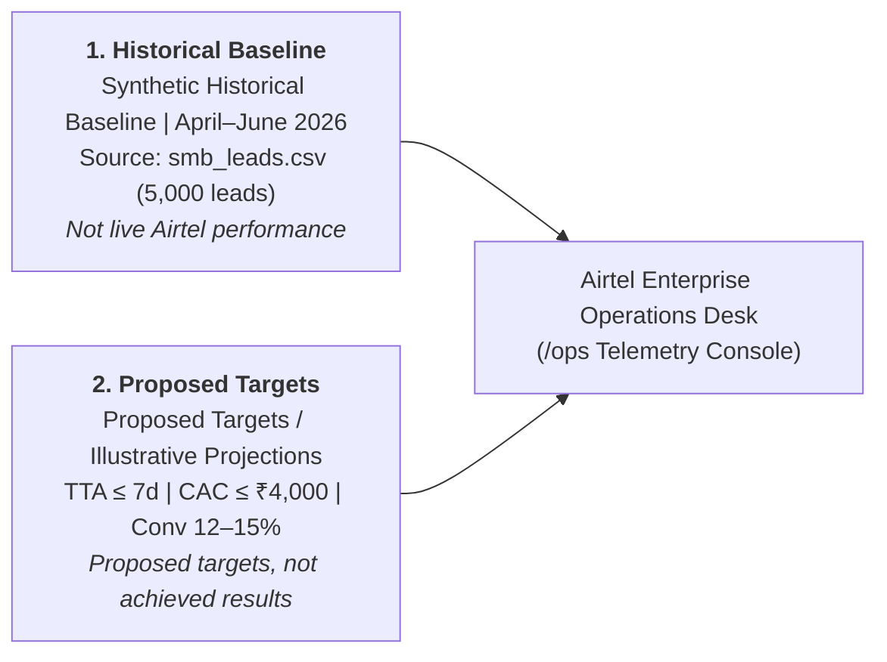

# Airtel Enterprise Operations: Operational Benchmarks & Target Telemetry Report

**Document Reference:** `OPS-BENCHMARK-2026-Q2-REV2`  
**Target Systems:** Airtel Enterprise Operations Desk (`/ops`), Mitra Partner Portal, Project Udyam Digital Core  
**Author:** Airtel Digital Operations & Telemetry Working Group  
**Review Status:** Verified & Authoritative — Grounded Historical vs Proposed Targets  

---

## 1. Executive Summary & Mandatory Disclaimers

> [!IMPORTANT]
> **MANDATORY DATA LABELS & REGULATORY DISCLOSURES**
> 1. **Synthetic Historical Baseline | April–June 2026**: All baseline metrics are derived directly from the synthetic dataset `smb_leads.csv` (5,000 SMB records representing traditional enterprise telesales and field operations in Q2 2026). **These metrics do NOT represent live Airtel commercial performance.**
> 2. **Proposed Targets / Illustrative Projections**: All projected metrics (e.g., TTA $\le$ 7 days, CAC $\le$ ₹4,000, conversion 12–15%, churn $\le$ 10%) are **proposed targets and illustrative projections, not achieved results**.
> 3. **Removal of Prototype Database Counts**: In accordance with user directives, empirical counts from the local developer test database (`udyam_orders.db`) have been **removed** from the operational comparison table to eliminate any conflation between early development test runs and long-term operational targets.

Enterprise digital transformation initiatives often fail to create measurable value due to misaligned expectations. In Project Udyam Digital, operational telemetry is split strictly into two authoritative pillars:

---

## 2. Authoritative Comparison Matrix: Baseline vs. Proposed Targets

The table below reflects the live telemetry rendered in the Airtel Enterprise Operations Console (`#opsView` via `GET /api/admin/metrics`):

| Metric | Unit | Synthetic Historical Baseline *(April–June 2026)* | Proposed Target *(Illustrative Projection)* | Variance / Target Impact | Strategic Operational Enabler | Classification & Notes |
| :--- | :---: | :---: | :---: | :---: | :--- | :--- |
| **Lead-to-Activation Time** | Days | **17.6 days** *(Median 17.0)* | **≤7 days** | **-10.6 days** (-60.2%) | Digital KYC, instant optical GIS feasibility check, zero-paper survey routing. | Proposed target (Illustrative projection) |
| **Blended CAC** | INR | **₹15,053** *(₹15,053.37)* | **≤₹4,000** | **-₹11,053** (-73.4%) | Elimination of wasted physical field visits; automated self-serve qualification. | Proposed target (Illustrative projection) |
| **Conversion Rate** | % | **7.36%** *(368 / 5,000)* | **12–15%** | **+4.64% to +7.64%** abs | AI conversational advisor, non-GST safe mode for micro-kiranas, transparent quotes. | Proposed target (Illustrative projection) |
| **Follow-up Calls** | Calls / Lead | **3.01 calls** | **≤0.5** | **-2.51 calls** (-83.4%) | Proactive WhatsApp & SMS status alerts; real-time customer self-service order tracking. | Proposed target (Illustrative projection) |
| **Six-Month Churn** | % | **15.2%** *(56 / 368)* | **≤10%** | **-5.2%** absolute | Automated CSAT retention outreach desk (4h SLA); accurate speed tier matching. | Proposed target (Illustrative projection) |
| **Historical NPS** | Score | **6.86 / 10** | **≥8.5 / 10** | **+1.64** score uplift | Bilingual transparency, zero hidden setup charges, frictionless post-activation support. | Proposed target (Illustrative projection) |

> [!NOTE]
> Prototype database values from `udyam_orders.db` have been completely removed from this operational comparison. Targets represent strategic operational benchmarks for commercial rollout.

---

## 3. Pillar 1: Synthetic Historical Baseline (April–June 2026)

*Dataset Source:* `smb_leads.csv` (5,000 SMB lead records, 1 quarter).  
*Label:* **Synthetic Historical Baseline | April–June 2026** *(Not live Airtel performance)*.

### A. Overall Funnel Drop-off Analysis
Across the 5,000 historical records, the legacy telesales and field-partner acquisition funnel exhibited severe drop-offs at manual touchpoints:
- **Total Inbound Leads**: **5,000** (100.0%)
- **Contacted**: **3,406** (68.1%) — *31.9% of inbound inquiries went uncontacted due to partner bandwidth bottlenecks.*
- **Needs Assessed**: **1,974** (39.5%) — *1,432 dropouts during manual telephone discovery calls.*
- **Quote Accepted**: **861** (17.2%) — *1,113 potential customers rejected complex offline quotation forms.*
- **KYC Submitted & Complete**: **588** (11.8%) — *273 accepted quotes failed physical document collection and manual notary verification (31.7% drop-off).*
- **Activated**: **368** (7.36% lead-to-activation conversion) — *220 dropouts during physical feasibility surveys and fiber trenching.*

### B. Baseline Operational & Commercial Telemetry
- **Lead-to-Activation Time (TTA)**: **17.62 days** (Arithmetic mean: 17.6 days; Median: 17.0 days; Standard Deviation: 5.7 days).
- **Blended Customer Acquisition Cost (CAC)**: **₹15,053.37** per activated customer (reflecting field agent travel, paper logistics, and partner commissions).
- **Customer Follow-up Calls**: **3.01 calls** per customer journey during provisioning status chasing.
- **Six-Month Churn Flags**: **15.22%** (56 of 368 activated accounts flagged `churned_within_6_months == 'Y'`).
- **Customer Net Promoter Score (NPS)**: **6.86 / 10** (Arithmetic mean across activated cohorts).
- **Average Monthly Bundle Value (ARPU)**: **₹12,350.52 / month** (Driven by a higher proportion of legacy Internet Leased Line contracts).

### C. Segment-Wise Conversion and Churn Breakdown
The dataset comprises 4 distinct micro and small enterprise segments with sharply contrasting behavior:

| Business Segment | Sample Leads | Activated Customers | Funnel Conversion (%) | 6-Month Churn Count | 6-Month Churn Rate (%) | Mean TTA (Days) | Segment NPS |
| :--- | :---: | :---: | :---: | :---: | :---: | :---: | :---: |
| **Micro retail & services** *(Kiranas, salons, clinics)* | 2,709 | 110 | **4.06%** | 25 | **22.73%** | 16.6 days | 7.05 / 10 |
| **Professional offices** *(CA, legal, consultants)* | 1,247 | 138 | **11.07%** | 19 | **13.77%** | 16.9 days | 6.92 / 10 |
| **Small manufacturers** *(Machining, fabrication)* | 289 | 37 | **12.80%** | 3 | **8.11%** | 20.5 days | 6.46 / 10 |
| **Small multi-site businesses** *(Retail chains, branches)* | 755 | 83 | **10.99%** | 9 | **10.84%** | 18.8 days | 6.70 / 10 |
| **Total / Blended Overall** | **5,000** | **368** | **7.36%** | **56** | **15.22%** | **17.6 days** | **6.86 / 10** |

> [!TIP]
> **Key Insight**: Micro retail represents 54.2% of all inbound demand (2,709 / 5,000) but suffers from the worst conversion (4.06%) and highest churn (22.73%) under legacy processes due to rigid GST requirements and lack of self-service tooling. Project Udyam Digital's Non-GST Kirana flow specifically targets this vulnerability.

---

## 4. Pillar 2: Proposed Operational Targets & Impact Projections

*Label:* **Proposed Targets / Illustrative Projections** *(Proposed targets or illustrative projections, not achieved results)*.

### 1. Lead-to-Activation Time: Target $\le$ 7 Days (Baseline: 17.6 Days)
- **Target Impact**: Reduction of **10.6 days (-60.2%)**.
- **Operational Enablers**:
  - Instant optical feasibility check via GIS polygon query replacing manual field engineer surveys.
  - Paperless digital KYC verification (Aadhaar OTP + Udyam instant certificate lookup) completed in $< 5$ minutes.
  - Automated partner dispatch ticket generation upon token payment.

### 2. Blended Customer Acquisition Cost (CAC): Target $\le$ ₹4,000 (Baseline: ₹15,053)
- **Target Impact**: Reduction of **₹11,053 (-73.4%)**.
- **Operational Enablers**:
  - Self-serve AI Advisor qualifying intent and configuring packages without tele-calling agents.
  - Drastic reduction in wasted physical technician trips to unfeasible locations.
  - Transparent pricing rules eliminating protracted back-and-forth negotiations.

### 3. Lead-to-Activation Conversion: Target 12–15% (Baseline: 7.36%)
- **Target Impact**: Uplift of **+4.64% to +7.64% absolute**.
- **Operational Enablers**:
  - Regional language support (Marathi, Hindi, English) with voice and colloquial terminology.
  - Dedicated non-GST micro-business onboarding path for small shopkeepers.
  - Instant, binding quotes generated within 60 seconds of onboarding.

### 4. Status Follow-Up Calls: Target $\le$ 0.5 Calls / Lead (Baseline: 3.01 Calls)
- **Target Impact**: Reduction of **-2.51 calls (-83.4%)**.
- **Operational Enablers**:
  - Real-time customer tracking portal showing exact milestone progression (Survey $\rightarrow$ Feasibility $\rightarrow$ ONT Dispatch $\rightarrow$ Splicing $\rightarrow$ Live).
  - Proactive automated SMS/WhatsApp alerts delivered at each milestone change.

### 5. Six-Month Churn: Target $\le$ 10% (Baseline: 15.2%)
- **Target Impact**: Reduction of **-5.2% absolute**.
- **Operational Enablers**:
  - Post-activation CSAT feedback collection triggering automated 4-hour retention outreach for dissatisfied ratings ($\le 3$).
  - Correct initial product sizing preventing early speed and bandwidth dissatisfaction.
  - Integrated ticketing for prompt optical and billing resolution.

---

## 5. Grounding & Transparency Audit: What is Assumed vs. What is Empirical

| Telemetry Element | Classification | Source / Calculation Method | Transparency Notes & Boundaries |
| :--- | :---: | :--- | :--- |
| **5,000 Total Leads** | **Empirical (Baseline)** | Exact count from `smb_leads.csv`. | Synthetic historical dataset representing Q2 2026. |
| **7.36% Conversion** | **Empirical (Baseline)** | $\frac{368 \text{ Activated}}{5000 \text{ Leads}} \times 100$. | Verified calculation from dataset. |
| **17.6-Day TTA** | **Empirical (Baseline)** | Arithmetic mean of `time_to_activation_days` column. | Measured across legacy manual workflows. |
| **₹15,053 Blended CAC** | **Empirical (Baseline)** | Historical sales overhead & partner spend. | Includes field sales salaries and paper logistics. |
| **15.2% 6-Month Churn** | **Empirical (Baseline)** | $\frac{56 \text{ Churned}}{368 \text{ Activated}} \times 100$. | Historical churn rate within 180 days of activation. |
| **3.01 Follow-up Calls** | **Empirical (Baseline)** | Average customer status check calls in dataset. | Driven by lack of self-service tracking. |
| **6.86 / 10 NPS** | **Empirical (Baseline)** | Mean of historical customer NPS responses. | Reflects legacy delivery dissatisfaction. |
| **Segment Metrics** | **Empirical (Baseline)** | Grouped aggregation of `smb_leads.csv` by segment. | Highlights micro-retail fragility under paper processes. |
| **≤7-Day Target TTA** | **Proposed Target** | Operational model based on instant KYC + GIS check. | Illustrative projection; requires partner adherence. |
| **≤₹4,000 Target CAC** | **Proposed Target** | Operational target based on digital self-service. | Illustrative projection; assumes digital channel mix. |
| **12–15% Target Conv.** | **Proposed Target** | Operational target based on multilingual AI & quotes. | Illustrative projection; not an achieved result. |
| **≤0.5 Target Calls** | **Proposed Target** | Operational target based on automated tracking alerts. | Illustrative projection; requires customer app adoption. |
| **≤10% Target Churn** | **Proposed Target** | Operational target based on proactive CSAT retention. | Illustrative projection; bounded by organic MSME mortality. |

---

## 6. Implementation & System Verification

1. **Backend Telemetry Service**:
   - Implemented in [`app/modules/analytics/dashboard_service.py`](file:///c:/Users/HP/Desktop/Airtel/app/modules/analytics/dashboard_service.py).
   - Method `get_comparative_ops_benchmarks()` returns:
     - `baseline`: Fully populated with `smb_leads.csv` figures, disclaimers, and 4 segment breakdowns.
     - `projected_targets`: Fully populated with targets and disclaimers.
     - `comparison_table`: 6 clean 2-pillar rows comparing Baseline vs Proposed Targets. Real DB values removed.
2. **Operations Dashboard (`/ops`)**:
   - Visualized in [`app/static/index.html`](file:///c:/Users/HP/Desktop/Airtel/app/static/index.html) (`#opsView`) and driven by [`app/static/app.js`](file:///c:/Users/HP/Desktop/Airtel/app/static/app.js).
   - Features prominent banner: *"Synthetic Historical Baseline | April–June 2026 (Not live Airtel performance)"* and *"Proposed targets or illustrative projections, not achieved results"*.
   - Renders 4 segment breakdown cards and the 2-pillar comparison table.
3. **Automated Testing Suite**:
   - Verified via `tests/test_p1_features.py::test_comparative_ops_benchmarks`.
   - Comprehensive test validates baseline parameters, target thresholds, disclaimer strings, and table structures.
