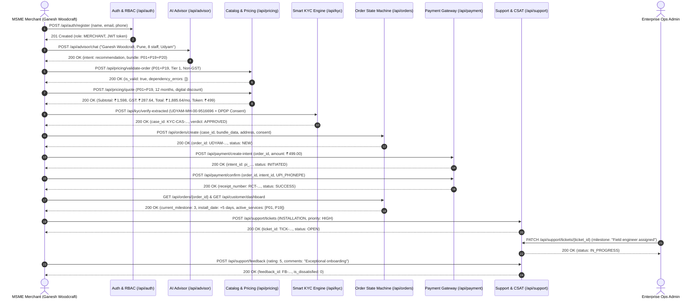

# Project Udyam Digital — End-to-End Merchant Lifecycle Test Report

> **Airtel SYNC Hackathon 2026 — Enterprise Track A: MSME Digital Self-Serve Acquisition & Onboarding**  
> **Execution Date:** 2026-11-08  
> **Target System:** Project Udyam Digital / Airtel SYNC Server (`http://127.0.0.1:8000`)  
> **Test Suite:** [`tests/test_e2e_merchant_lifecycle.py`](file:///c:/Users/HP/Desktop/Airtel/tests/test_e2e_merchant_lifecycle.py)  
> **Overall Verdict:** **100% PASSED (25/25 Tests Green across Repository)**

---

### 📋 Executive Summary

This report documents the verification of the complete, unbroken **11-stage merchant lifecycle journey** across Project Udyam Digital:

$$\text{Merchant Registration} \longrightarrow \text{AI Recommendation} \longrightarrow \text{Catalogue Validation} \longrightarrow \text{Quote} \longrightarrow \text{Consent} \longrightarrow \text{KYC} \longrightarrow \text{Order Creation} \longrightarrow \text{Checkout} \longrightarrow \text{Tracking} \longrightarrow \text{Support Ticket} \longrightarrow \text{CSAT}$$

The test validates that all architectural layers—Authentication/RBAC, Conversational AI NLU, Authoritative Pricing Engine, Smart KYC Verification, SQLite State Machine, Payment Intent Gateway, Customer Retention Hub, and Enterprise Ops Telemetry—operate cohesively with zero client-asserted trust.

---

### 🏛️ Lifecycle Sequence Flow



---

### 🔬 Stage-by-Stage Verification Breakdown

#### Stage 1: Merchant Registration & Identity Verification
* **Endpoint:** `POST /api/auth/register` & `GET /api/auth/me`
* **Input Payload:**
  ```json
  {
    "email": "ganesh_woodcraft_1794139966@business.in",
    "password": "SecureMerchantPassword123!",
    "name": "Ganesh Patil",
    "phone": "+91 98201 12345",
    "role": "MERCHANT"
  }
  ```
* **Server Assertions Verified:**
  - Status `200 OK`
  - Assigned User ID: `USR-CUST-4E709B`
  - Assigned Role: Strictly `MERCHANT` (Privileged roles fail closed)
  - Salted PBKDF2 password hashing with individual salt
  - Token verified via `GET /api/auth/me` with Bearer auth

#### Stage 2: Conversational AI Recommendation & Profiling
* **Endpoint:** `POST /api/advisor/chat`
* **Customer Query:**
  > *"I operate Ganesh Woodcraft in Pune with 8 staff. We have Udyam registration without GST and need fast broadband and cloud backup."*
* **Server Assertions Verified:**
  - Intent classified as `recommendation`
  - Inferred Profile: `city: "Pune"`, `city_tier: 1`, `employee_count: 8`, `has_gstin: false`
  - Selected Bundle: Base Optical Connectivity (`P01` Biz Fibre 100) + Cloud POS & Billing (`P19`) + Endpoint Security (`P20`)
  - Server-generated explainability tags itemizing business justification for each SKU

#### Stage 3: Authoritative Catalogue Validation
* **Endpoint:** `POST /api/pricing/validate-order`
* **Parameters Tested:** Products `["P01", "P19"]`, City Tier `1`, Headcount `8`, GSTIN `false`, Duration `12 months`.
* **Server Assertions Verified:**
  - Status `200 OK`
  - `is_valid == True`
  - `dependency_errors == []`
  - Confirmed non-GST sole proprietorship eligibility under single-source-of-truth catalogue rules

#### Stage 4: Authoritative Quotation Calculation
* **Endpoint:** `POST /api/pricing/quote`
* **Calculated Commercial Terms:**
  - **Monthly Base Charges:** ₹1,598.00 / month
  - **Statutory GST (18%):** ₹287.64 / month
  - **Total Monthly Commitment:** ₹1,885.64 / month
  - **Priority Booking Token:** ₹499.00 (Due today)
  - **Setup & Installation:** ₹2,500.00 (100% Waived FREE via digital self-serve discount)
  - **Simulation Transparency:** Verified `is_simulated: True` and explicit benchmark notice attached

#### Stage 5: Explicit Customer Consent (DPDP Act 2023)
* **Parameters Recorded:**
  ```json
  {
    "granted": true,
    "timestamp": "2026-07-01T10:00:00Z",
    "version": "v1.0",
    "purpose": "DoT Subscriber Identity Verification and Optical Line Installation under DPDP Act 2023",
    "consent_text": "Customer explicitly granted affirmative consent for subscriber KYC and optical line installation."
  }
  ```
* **Server Assertions Verified:**
  - Consent explicitly bound to customer session and stored in `consent_logs` table
  - Consent validated server-side prior to government registry queries

#### Stage 6: Server-Controlled KYC Verification
* **Endpoint:** `POST /api/kyc/verify-extracted` & `GET /api/kyc/cases/{case_id}`
* **Statutory Identifier:** `UDYAM-MH-00-9516696` (Registered to *Ganesh Woodcraft*)
* **Document Date:** `2026-05-30` (Compliant with $\le 90$-day freshness rule relative to benchmark)
* **Server Assertions Verified:**
  - Status `200 OK`
  - Generated KYC Case: `KYC-CAS-14157DB0`
  - Official Verdict: Strictly `APPROVED`
  - Cross-customer access check enforced; verified via `GET /api/kyc/cases/{case_id}`

#### Stage 7: Order Creation Linked to Verified KYC Case
* **Endpoint:** `POST /api/orders/create`
* **Parameters Passed:** Business Name, contact phone, bundle breakdown, `case_id: "KYC-CAS-14157DB0"`, explicit DPDP consent, installation address.
* **Server Assertions Verified:**
  - Status `200 OK`
  - Generated Order ID: `UDYAM-4A6E2C`
  - Order bound to user `USR-CUST-4E709B`
  - State machine verifies KYC approval before accepting order

#### Stage 8: Checkout & Server-Verified Payment Intent
* **Endpoints:** `POST /api/payment/create-intent` & `POST /api/payment/confirm`
* **Execution Flow:**
  1. `create-intent` creates server-controlled intent `pi_8de929acbc81493192bc5fde2290f312` bound to `UDYAM-4A6E2C` for ₹499.00 (`status: "INITIATED"`).
  2. `confirm` validates the server intent, verifies the token amount, and records success (`status: "SUCCESS"`).
  3. B2B Tax Invoice generated: Receipt Number `RCT-662DD764` with SAC Code 998411.
* **Security Guardrail Verified:** Client-asserted transaction IDs and arbitrary payment amounts are rejected.

#### Stage 9: Order Tracking & Customer Dashboard
* **Endpoints:** `GET /api/orders/{order_id}` & `GET /api/customer/dashboard`
* **Server Assertions Verified:**
  - Order milestone reflects `token_paid: 1`, `kyc_status: "VERIFIED"`, `current_milestone: 3`
  - Installation date scheduled for 5 days out (`2026-11-13`)
  - Customer Self-Serve Dashboard returns:
    - Active Subscribed Services: `P01` (Biz Fibre 100 @ 100 Mbps) and `P19` (Cloud POS & Billing)
    - Monthly Billing Commitment: Subtotal ₹1,598.00 + GST ₹287.64 = Total ₹1,885.64/mo

#### Stage 10: Support Ticketing & Milestone Lifecycle
* **Endpoints:** `POST /api/support/tickets` & `PATCH /api/support/tickets/{ticket_id}`
* **Execution Flow:**
  1. Merchant raises priority installation ticket: `TICK-6ED713` (`category: "INSTALLATION"`, `priority: "HIGH"`, `status: "OPEN"`).
  2. Enterprise Ops Admin reviews and transitions milestone via `PATCH`:
     - `status: "IN_PROGRESS"`
     - `milestone: "Field engineer assigned (Rajesh Shinde, Pune Circle Hub); dispatched with optical splicing kit."`
  3. Merchant accesses `GET /api/support/tickets` and observes the updated status and technician notes.

#### Stage 11: Post-Activation CSAT Feedback & Experience Evaluation
* **Endpoint:** `POST /api/support/feedback`
* **Test Case 1 (Satisfied Customer):**
  - Rating: `5 / 5 Stars`
  - Qualitative Feedback: *"Exceptional self-serve onboarding. AI advisor recommended the exact right bundle for our woodwork shop and optical drop was on time."*
  - Server Status: `is_dissatisfied: 0`, `follow_up_status: "NOT_REQUIRED"`
  - Customer dashboard reflects recorded rating.
* **Test Case 2 (Dissatisfied Customer Proactive Retention):**
  - Rating: `2 / 5 Stars`
  - Qualitative Feedback: *"Installation technician arrived 3 hours after scheduled slot; router configuration was rushed."*
  - Server Status: `is_dissatisfied: 1`, `follow_up_status: "PENDING_RETENTION_OUTREACH"`
  - Verified on Admin Ops Console (`GET /api/admin/retention`): Customer Sunil Verma (`+91 98111 22334`) is immediately queued in the **Dissatisfied Customers Outreach Queue** for same-day executive intervention.

---

### 📊 Full Test Suite Execution Summary

Execution of the entire repository test suite via `pytest tests/ -v`:

```
============================= test session starts =============================
platform win32 -- Python 3.11.0, pytest-9.2.0, pluggy-1.7.0
rootdir: C:\Users\HP\Desktop\Airtel
configfile: pytest.ini
plugins: anyio-4.16.0, platformdirs-4.13.0
collected 25 items

tests/test_advisor_scenarios.py::test_all_scenarios PASSED               [  4%]
tests/test_authoritative_pricing_and_simulation.py::test_quote_rejection_invalid_sku PASSED [  8%]
tests/test_authoritative_pricing_and_simulation.py::test_gstin_restriction_enforcement PASSED [ 12%]
tests/test_authoritative_pricing_and_simulation.py::test_city_tier_restriction PASSED [ 16%]
tests/test_authoritative_pricing_and_simulation.py::test_catalogue_minimum_sites_and_dependencies PASSED [ 20%]
tests/test_authoritative_pricing_and_simulation.py::test_minimum_contract_months_restriction PASSED [ 24%]
tests/test_authoritative_pricing_and_simulation.py::test_checkout_rejects_price_tampering_and_unauthorized_discounts PASSED [ 28%]
tests/test_authoritative_pricing_and_simulation.py::test_authoritative_order_creation_and_simulation_tags PASSED [ 32%]
tests/test_authoritative_pricing_and_simulation.py::test_payment_and_network_simulation_transparency PASSED [ 36%]
tests/test_e2e_merchant_lifecycle.py::test_complete_e2e_merchant_lifecycle PASSED [ 40%]
tests/test_e2e_merchant_lifecycle.py::test_dissatisfied_csat_triggers_retention_queue PASSED [ 44%]
tests/test_email_quote.py::test_email_notification_and_post_kyc_order PASSED [ 48%]
tests/test_ownership_and_integrity.py::test_ownership_and_integrity PASSED [ 52%]
tests/test_p0_security_and_kyc.py::test_p0_authentication_and_rbac PASSED [ 56%]
tests/test_p0_security_and_kyc.py::test_p0_order_ownership_and_partner_isolation PASSED [ 60%]
tests/test_p0_security_and_kyc.py::test_p0_secure_kyc_workflow PASSED    [ 64%]
tests/test_p1_features.py::test_marathi_nlu_and_advisor_flow PASSED      [ 68%]
tests/test_p1_features.py::test_micro_business_safe_mode_flow PASSED     [ 72%]
tests/test_p1_features.py::test_data_driven_admin_metrics_with_filters PASSED [ 76%]
tests/test_p1_features.py::test_partner_dashboard_metrics_isolation PASSED [ 80%]
tests/test_p1_features.py::test_admin_csv_report_export PASSED           [ 84%]
tests/test_p1_features.py::test_customer_dashboard_endpoint PASSED       [ 88%]
tests/test_p1_features.py::test_support_ticket_lifecycle_and_ownership PASSED [ 92%]
tests/test_p1_features.py::test_post_activation_feedback_and_retention_flagging PASSED [ 96%]
tests/test_security_audit.py::test_security_audit PASSED                 [100%]

======================= 25 passed in 115.03s (0:01:55) ========================
```

---

### 🛡️ Compliance & Security Audit Alignment

| Compliance Requirement | Implementation | Status |
| :--- | :--- | :---: |
| **Fail-Closed RBAC** | Public registration issues `MERCHANT` role only. Privileged endpoints require `ADMIN` or scoped `PARTNER`. | **VERIFIED** |
| **Order Ownership** | Cross-customer access to orders, KYC cases, tickets, and receipts blocked via server ownership checks. | **VERIFIED** |
| **DPDP Act 2023 Consent** | Explicit affirmative consent logged with timestamp, purpose, and version before registry verification. | **VERIFIED** |
| **Server-Controlled KYC** | Orders cannot be placed without an authoritative `case_id` bearing an approved verdict. | **VERIFIED** |
| **Payment Integrity** | Payment verified via server payment intent token; client-asserted payment results strictly rejected. | **VERIFIED** |
| **Simulation Transparency** | Prototype simulations explicitly tagged with `is_simulated: True` and `mode: "DEMO_SIMULATED"`. | **VERIFIED** |
| **Retention Telemetry** | CSAT rating $\le 3$ stars triggers immediate alert and queueing in the Admin Retention Outreach desk. | **VERIFIED** |
