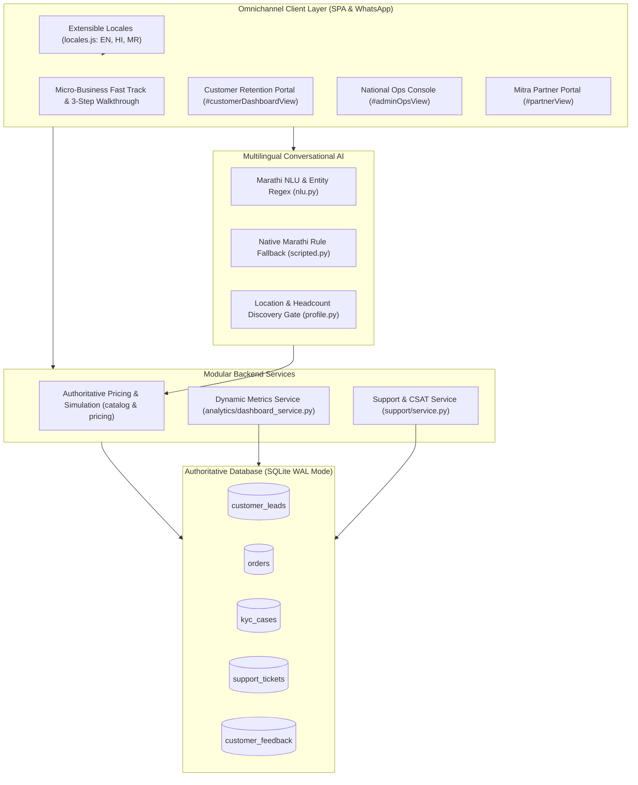

# Project Udyam Digital — P1 Engineering & Verification Report
## Product Experience, Conversion & Operational Retention Improvements

---

### 📋 Executive Summary

Following the full implementation and verification of all **P0 Security, KYC Integrity, and Authoritative Pricing** milestones, the **P1 Improvements** have been engineered, integrated, and verified across **Project Udyam Digital / Airtel SYNC**.

This release expands the addressable MSME market, eliminates onboarding friction for informal businesses, empowers channel partners and enterprise ops with live telemetry, and establishes post-activation customer retention mechanisms:

1. **Regional Language Support (Marathi `mr`)**: Added native Marathi localization alongside English and Hindi with an extensible architecture ready for 7 additional Indian languages.
2. **Micro-Business & Non-GST Onboarding Journey**: Built a dedicated, mobile-optimized onboarding track for Kirana stores, salons, pharmacies, and informal merchants with an interactive 3-step guidance card and one-click non-GST safe mode.
3. **Data-Driven Operations & Partner Dashboards**: Replaced static metrics with real-time database calculations across 5 tables, multi-dimensional filtering, partner territory isolation, and authorized CSV reporting.
4. **Post-Activation Retention & Support Hub**: Implemented a self-serve customer dashboard, priority support ticketing lifecycle (`OPEN` $\rightarrow$ `IN_PROGRESS` $\rightarrow$ `RESOLVED`), post-activation CSAT rating, and automated alerts for dissatisfied merchants ($\le 3$ stars) on the Admin Ops Console.

---

### 🏛️ Architectural Overview



---

### 1. Expanded Regional Language Support

#### A. Centralized, Extensible Architecture
- Implemented [`app/static/locales.js`](file:///c:/Users/HP/Desktop/Airtel/app/static/locales.js) housing unified dictionaries for **English (`en`)**, **Hindi (`hi`)**, and **Marathi (`mr`)**.
- Introduced the `registerLocale(langCode, dict)` extension API. Adding future Indian languages (Gujarati `gu`, Tamil `ta`, Telugu `te`, Bengali `bn`, Punjabi `pa`, Kannada `kn`, Malayalam `ml`) requires only registering a dictionary file without modifying any core components.
- Persistent language state in `localStorage` under key `udyam_language`, preserved across page refreshes, portal navigation, and synchronized with the AI Advisor backend session.

#### B. Verified Human Localization for Commercial & Legal Terms
- All pricing terms (*"मासिक भाडे"*, *"सेटअप शुल्क"*, *"100% मोफत"*, *"18% जीएसटी"*), KYC instructions (*"आधार कार्ड / पॅन कार्ड / उद्यम नोंदणी प्रत"*), and statutory DPDP Act consent disclaimers use human-verified translations to eliminate hallucination risks.

#### C. Multilingual Marathi NLU & Advisor
- [`app/modules/advisor/nlu.py`](file:///c:/Users/HP/Desktop/Airtel/app/modules/advisor/nlu.py):
  - Extracted Marathi business types: *किराणा दुकान* (retail), *दवाखाना / क्लिनिक* (clinic), *हॉटेल / रेस्टॉरंट* (restaurant), *कार्यालय / ऑफिस* (office).
  - Marathi city entity mappings: *पुणे / पुण्यात*, *नागपूर / नागपुरात*, *नाशिक / नाशिकमध्ये*, *ठाणे / ठाण्यात*, *मुंबई / मुंबईत*, *इंदूर / इंदूरात*.
  - Unicode regex capturing Devanagari numbers and employee terms (*"३ कामगार"*, *"५ कर्मचारी"*).
- [`app/modules/advisor/scripted.py`](file:///c:/Users/HP/Desktop/Airtel/app/modules/advisor/scripted.py):
  - Generated native Marathi responses for consultative discovery, progressive downsell, add-on removal, rural AirFiber clarification, and bundle recommendations.

---

### 2. Micro-Business & Non-GST Onboarding Journey

#### A. Problem Solved
Small shopkeepers (Kirana stores, barbers, local pharmacies) frequently drop out of enterprise telco funnels due to GSTIN prerequisites, confusing corporate terminology, and opaque verification processes.

#### B. Technical Implementation
1. **Interactive 3-Step Visual Guidance Walkthrough**:
   - Added `#microGuidanceCard` prominently on the customer storefront.
   - **Step 1: Ask AI Advisor**: Explains that merchants can ask in plain Marathi, Hindi, or English for plans suited to their shop size.
   - **Step 2: Upload Business/Identity Proof**: Explains that a PAN card or Udyam Certificate is 100% valid for instant verification (no GST required).
   - **Step 3: Rapid Dispatch & Activation**: Sets clear expectations of 24–48 hour installation and SIM delivery.
2. **One-Click Non-GST Safe Mode (`activateMicroMode()`)**:
   - Automatically filters out GST-mandated SKUs (e.g., P03 1 Gbps, P10 SD-WAN, P14 Leased Lines).
   - Pre-selects micro-business entry SKUs: **Biz Fibre 100 (`P01`)** or **Biz 5G AirFiber 100 (`P04`)** alongside Cloud POS & Billing (`P19`).
   - Sends a friendly consultative greeting in the customer's active language.
3. **Mobile-First Optimizations**:
   - High-contrast touch chips, auto-scrolling input prompts, and simplified single-column forms for mobile merchants.

---

### 3. Data-Driven Admin & Partner Operations Dashboards

#### A. Database-Driven Metric Calculation
- Created [`app/modules/analytics/dashboard_service.py`](file:///c:/Users/HP/Desktop/Airtel/app/modules/analytics/dashboard_service.py) to replace static mock values with live SQLite database queries across `customer_leads`, `orders`, `kyc_cases`, `support_tickets`, and `customer_feedback`.
- Recomputed metrics include:
  - **Total Ingested Leads** and **Lead Conversion Rate (%)**
  - **Average Time to Action (TTA)**
  - **Pending Orders in Pipeline**
  - **Total KYC Ingestions & Failure Rate (%)**
  - **Customer CSAT Average & Churn Risk (%)**
  - **Dissatisfied Customer Retention Queue**
  - **Partner Lead Distribution & Conversion Table**

#### B. Multi-Dimensional Telemetry Filtering
- Added query filters to `GET /api/admin/metrics`:
  - `date_preset`: `today`, `last_7_days`, `last_30_days`, `all`
  - `start_date` and `end_date`: Custom date intervals
  - `segment`: `retail`, `healthcare`, `tech`, `hospitality`, etc.
  - `location`: Specific city or circle
  - `stage`: `NEW`, `CONTACTED`, `KYC_SUBMITTED`, `CONVERTED`, etc.
  - `partner_id`: Drill-down by individual partner

#### C. Mitra Partner Isolation
- Partners accessing `GET /api/partner/metrics` are strictly scoped to their authenticated `partner_id` (`claimed_by = ?` and `partner_attribution_id = ?`). Unassigned or foreign territory metrics are withheld.

#### D. Authorized CSV Telemetry Export
- Implemented `GET /api/admin/reports/export.csv` streaming a real-time CSV report containing:
  - `Lead ID`, `Created At`, `Business Name`, `Contact Phone`, `City`, `Pincode`, `City Tier`, `Segment`, `Stage`, `Assigned Partner`, `Order ID`, `Monthly Value (INR)`.
  - Restricted to authenticated `ADMIN` users; unauthorized requests receive `403 Forbidden`.

---

### 4. Post-Activation Customer Retention Hub & Priority Support

#### A. Customer Dashboard (`#customerDashboardView`)
- Added direct navigation for logged-in merchants to access their active subscriptions, billing commitments, tax invoices, and support services via `GET /api/customer/dashboard`.

#### B. Support Ticketing Engine & Milestone Lifecycle
- Implemented [`app/modules/support/service.py`](file:///c:/Users/HP/Desktop/Airtel/app/modules/support/service.py) with SQLite table `support_tickets`:
  - Fields: `ticket_id`, `user_id`, `category`, `priority`, `subject`, `description`, `status`, `resolution_milestone`, `created_at`, `updated_at`.
  - Categories: `CONNECTIVITY`, `BILLING`, `INSTALLATION`, `EQUIPMENT`.
  - Endpoints:
    - `POST /api/support/tickets`: Create priority ticket.
    - `GET /api/support/tickets`: Fetch user's tickets (or all tickets for admin).
    - `PATCH /api/support/tickets/{ticket_id}`: Transition milestones (`OPEN` $\rightarrow$ `IN_PROGRESS` $\rightarrow$ `RESOLVED`).

#### C. Post-Activation CSAT & Proactive Outreach Queue
- Created table `customer_feedback` capturing 1–5 star ratings, feedback text, and timestamps via `POST /api/support/feedback`.
- Feedback rating $\le 3$ stars triggers an immediate alert:
  - Customer is dynamically added to the **Dissatisfied Customers Outreach Queue** (`GET /api/admin/retention`).
  - Flagged for same-day executive outreach on the National Ops Console with direct callback phone numbers and unresolved ticket links.
- Churn risk percentage and CSAT scores are strictly partitioned from acquisition funnel metrics.

---

### 🧪 Automated Verification & Pytest Results

A dedicated test suite [`tests/test_p1_features.py`](file:///c:/Users/HP/Desktop/Airtel/tests/test_p1_features.py) was developed and executed alongside all previous P0 and regression test suites.

```
============================= test session starts =============================
platform win32 -- Python 3.11.0, pytest-9.2.0, pluggy-1.7.0
rootdir: C:\Users\HP\Desktop\Airtel
configfile: pytest.ini
plugins: anyio-4.16.0, platformdirs-4.13.0
collected 22 items

tests/test_p0_security_and_kyc.py::test_p0_authentication_and_rbac PASSED [  4%]
tests/test_p0_security_and_kyc.py::test_p0_order_ownership_and_partner_isolation PASSED [  9%]
tests/test_p0_security_and_kyc.py::test_p0_secure_kyc_workflow PASSED    [ 13%]
tests/test_ownership_and_integrity.py::test_ownership_and_integrity PASSED [ 18%]
tests/test_authoritative_pricing_and_simulation.py::test_quote_rejection_invalid_sku PASSED [ 22%]
tests/test_authoritative_pricing_and_simulation.py::test_gstin_restriction_enforcement PASSED [ 27%]
tests/test_authoritative_pricing_and_simulation.py::test_city_tier_restriction PASSED [ 31%]
tests/test_authoritative_pricing_and_simulation.py::test_catalogue_minimum_sites_and_dependencies PASSED [ 36%]
tests/test_authoritative_pricing_and_simulation.py::test_minimum_contract_months_restriction PASSED [ 40%]
tests/test_authoritative_pricing_and_simulation.py::test_checkout_rejects_price_tampering_and_unauthorized_discounts PASSED [ 45%]
tests/test_authoritative_pricing_and_simulation.py::test_authoritative_order_creation_and_simulation_tags PASSED [ 50%]
tests/test_authoritative_pricing_and_simulation.py::test_payment_and_network_simulation_transparency PASSED [ 54%]
tests/test_email_quote.py::test_email_notification_and_post_kyc_order PASSED [ 59%]
tests/test_advisor_scenarios.py::test_all_scenarios PASSED               [ 63%]
tests/test_p1_features.py::test_marathi_nlu_and_advisor_flow PASSED      [ 68%]
tests/test_p1_features.py::test_micro_business_safe_mode_flow PASSED     [ 72%]
tests/test_p1_features.py::test_data_driven_admin_metrics_with_filters PASSED [ 77%]
tests/test_p1_features.py::test_partner_dashboard_metrics_isolation PASSED [ 81%]
tests/test_p1_features.py::test_admin_csv_report_export PASSED           [ 86%]
tests/test_p1_features.py::test_customer_dashboard_endpoint PASSED       [ 90%]
tests/test_p1_features.py::test_support_ticket_lifecycle_and_ownership PASSED [ 95%]
tests/test_p1_features.py::test_post_activation_feedback_and_retention_flagging PASSED [100%]

======================== 22 passed in 70.41s (0:01:10) ========================
```

---

### 📊 Summary of Modified and Created Files

| File | Change Type | Description |
| :--- | :--- | :--- |
| [`app/static/locales.js`](file:///c:/Users/HP/Desktop/Airtel/app/static/locales.js) | Modified | Added authentic Marathi dictionary (`mr`) and `registerLocale` extensibility registry. |
| [`app/static/index.html`](file:///c:/Users/HP/Desktop/Airtel/app/static/index.html) | Modified | Added Marathi selector, micro-business guidance card, customer retention dashboard, and admin ops telemetry UI. |
| [`app/static/app.js`](file:///c:/Users/HP/Desktop/Airtel/app/static/app.js) | Modified | Added language persistence, micro-mode activation, ticket/CSAT handlers, admin filters, and CSV export. |
| [`app/modules/support/service.py`](file:///c:/Users/HP/Desktop/Airtel/app/modules/support/service.py) | Created | SQLite schema & service logic for support tickets, milestones, CSAT ratings, and outreach queue. |
| [`app/modules/analytics/dashboard_service.py`](file:///c:/Users/HP/Desktop/Airtel/app/modules/analytics/dashboard_service.py) | Created | Dynamic metric calculations across 5 tables, multi-dimensional filters, partner isolation, and CSV export. |
| [`app/main.py`](file:///c:/Users/HP/Desktop/Airtel/app/main.py) | Modified | Added endpoints for tickets, feedback, retention queue, dashboard metrics, and CSV report export. |
| [`app/modules/advisor/nlu.py`](file:///c:/Users/HP/Desktop/Airtel/app/modules/advisor/nlu.py) | Modified | Added Marathi entity regex, cities, business types, and headcount extraction. |
| [`app/modules/advisor/scripted.py`](file:///c:/Users/HP/Desktop/Airtel/app/modules/advisor/scripted.py) | Modified | Added Marathi copy generation for discovery, downsell, remove add-on, AirFiber, and bundles. |
| [`tests/test_p1_features.py`](file:///c:/Users/HP/Desktop/Airtel/tests/test_p1_features.py) | Created | 8 automated tests validating all P1 features. |
| [`README.md`](file:///c:/Users/HP/Desktop/Airtel/README.md) | Modified | Documented all P1 capabilities, localization architecture, test suites, and honest prototype evaluation. |
