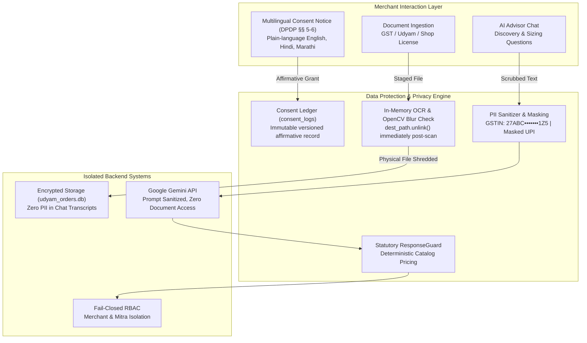

# Privacy & Security Note: Statutory DPDP Act Compliance & Architecture

**AIRTEL SYNC · PROJECT UDYAM DIGITAL**  
*Enterprise Track A: MSME Digital Self-Serve Acquisition & Onboarding*  
**Document Reference:** `UDYAM-SEC-DPDP-2026-REV1`  
**Governing Regulation:** Digital Personal Data Protection Act, 2023 (DPDP Act, India)  
**Classification:** Public Engineering & Compliance Documentation  

---

## Executive Summary

This document specifies the privacy, data governance, and cryptographic architecture implemented across **Project Udyam Digital**. It details what data is collected from Micro, Small, and Medium Enterprise (MSME) owners, why it is required, where it flows, how long it is retained, and how it is protected against the statutory requirements of India's **Digital Personal Data Protection Act, 2023 (DPDP Act)**.

The controls detailed in **Section 02** are fully implemented, automated, and verified via regression tests within the codebase. **Section 03** transparently contrasts prototype reference implementations against enterprise production deployments.

```
┌─────────────────────────────────┐   ┌─────────────────────────────────┐   ┌─────────────────────────────────┐   ┌─────────────────────────────────┐
│  Ask Only What Activation Needs │   │   Consent Before Verification   │   │   Ephemeral Document Shredding  │   │      AI Talks, Never Decides    │
│  ~5 structured discovery inputs │   │  Multilingual affirmative ledger│   │  In-memory OCR; physical images │   │  Rules & catalog price quotes;  │
│  Zero Aadhaar/PAN/OTP in chat.  │   │  (EN/HI/MR) prior to registries.│   │  shredded immediately post-scan.│   │  LLM never accesses documents.  │
└─────────────────────────────────┘   └─────────────────────────────────┘   └─────────────────────────────────┘   └─────────────────────────────────┘
```

---

## 01 Data Map

The matrix below maps every data element collected across the customer onboarding lifecycle, its legal basis under the DPDP Act, processing boundary, and retention lifecycle:

| Data Category | Specific Elements Collected | Statutory / Operational Purpose (Why) | Processing Boundary & Storage (Where) | Retention & Disposal Schedule (How Long) |
| :--- | :--- | :--- | :--- | :--- |
| **Conversational Chat & Business Profile** | Business type, operational city, pincode, employee headcount, number of sites, bandwidth requirements, optional GSTIN. | Recommend eligible connectivity and SaaS bundles; establish technical feasibility. | Operational store (`udyam_orders.db`). Anonymized chat queries pass to Gemini LLM with PII stripped. | Active session duration; deleted after 90 days for unconverted sessions (production target). |
| **KYC Verification Documents** | GST Certificate, Udyam Certificate, Shop & Establishment License, Signatory ID, Address Proof. | Verify legal identity and statutory telecom subscriber compliance (DoT regulations). | Secure local staging (`uploads/`). **Never forwarded to LLM or exposed to sales partners.** | **Ephemeral**: Physical file deleted immediately post-OCR via `unlink()`. Max 7 days if flagged for manual review. |
| **Verified Regulatory Details** | Extracted legal business name, trade name, active status, filing date, address, document blur variance, SHA-256 hash. | Prove regulatory validation and document authenticity for telecom audit. | Encrypted database table (`kyc_cases`). Identifiers masked on client and partner displays. | Duration of active commercial contract plus statutory telecom audit retention (2 years post-churn). |
| **Statutory Consent Ledger** | Customer ID, customer email, consent type, version (`v1.0`), purpose text, affirmative grant status, timestamp. | Immutable evidence of informed customer consent under DPDP §§ 5–6. | Dedicated audit table (`consent_logs`). Append-only ledger with session attribution. | Retained for the lifetime of the business relationship as statutory legal proof. |
| **Payment Intent & Booking Token** | Token amount (₹1,000), transaction reference, billing schedule, masked UPI ID (`ab***@okhdfcbank`). | Reserve technician installation slot; initiate recurring mandate via NPCI. | Order database (`orders`). UPI handles masked; full bank account numbers never stored. | Duration of active subscription billing cycle. |
| **Post-Activation CSAT & Tickets** | CSAT rating (1–5), issue category, grievance narrative, technician milestones, partner notes. | Measure subscriber satisfaction, trigger proactive retention outreach, and resolve faults. | Customer service tables (`customer_feedback`, `support_tickets`). Accessible only to assigned staff. | Duration of customer contract plus 12 months for quality assurance analysis. |

---

## 02 Controls Built into the Design



### 1. Affirmative Customer Consent (DPDP Act §§ 5–6)
* **Pre-Verification Consent Gate**: Under [`app/main.py::verify_extracted_kyc()`](file:///c:/Users/HP/Desktop/Airtel/app/main.py#L473-L491), explicit customer consent is mandatory. Any verification request lacking affirmative consent fails closed with HTTP 400 (`Statutory consent required`).
* **Multilingual Versioned Notice**: Presented in the user's chosen language (English, Hindi, or Marathi), detailing:
  - Exact purposes: Statutory verification of GSTIN/Udyam under DoT regulations.
  - Parties with access: Authorized Airtel telecom verification personnel only.
  - Retention period: Instant document disposal post-validation.
  - Customer rights: Right to withdraw consent and request data erasure.
* **Immutable Consent Ledger**: Stored in the `consent_logs` table with customer ID, email, consent version (`v1.0`), purpose, and precise timestamp.
* **Decoupled Purposes**: Statutory KYC consent is strictly decoupled from optional WhatsApp milestone alerts and marketing communications. Opt-out retains communications inside the web portal.

### 2. Data Minimisation & PII Scrubbing
* **No Sensitive Credentials in Chat**: The Conversational AI Advisor asks only ~5 operational discovery questions (business type, location, employee count, sites, bandwidth needs). It **never asks for Aadhaar, PAN, debit/credit cards, or bank account numbers**.
* **Display Masking**:
  - GSTINs are masked on all summary and partner views: `27ABC•••••••1Z5`.
  - UPI IDs are masked during checkout and order tracking: `sh***@okhdfcbank`.
* **Non-GST Micro-Business Safe Mode**: Micro-enterprises (Kiranas, salons, pharmacies) operating below the ₹40 Lakh mandatory GST threshold are routed through a dedicated non-GST path. This eliminates unnecessary tax document collection, accepting Udyam numbers or local Trade/Shop licenses instead.

### 3. Ephemeral Document Protection & Zero-Trust Verification
* **Immediate Physical Document Shredding**:
  Uploaded documents are staged temporarily for processing and immediately destroyed. Implemented in [`app/main.py::upload_kyc_document()`](file:///c:/Users/HP/Desktop/Airtel/app/main.py#L291-L302):
  ```python
  try:
      with open(dest_path, "wb") as buffer:
          shutil.copyfileobj(file.file, buffer)
      ocr_result = await ocr_engine.scan_document(str(dest_path))
  finally:
      # Secure Disposal: Physical document is deleted immediately after OCR extraction
      if dest_path.exists():
          dest_path.unlink()
  ```
* **Server-Side Sharpness & Tampering Check**: OpenCV Laplacian variance analysis is executed entirely on the server ([`OCR_MIN_BLUR_VARIANCE = 100.0`](file:///c:/Users/HP/Desktop/Airtel/app/config.py#L25)). Client-side blur assertions are rejected.
* **Zero LLM Document Exposure**: Raw documents, scanned images, and full OCR text dumps are **never transmitted to Google Gemini or any external model**. The LLM operates strictly on structured business profile tokens.

### 4. Role-Based Access Control (RBAC) & Partner Isolation
* **Server-Side Authorization**: Every protected endpoint enforces token authentication via [`verify_role_access()`](file:///c:/Users/HP/Desktop/Airtel/app/main.py). Public registrations are restricted strictly to `ROLE_MERCHANT`.
* **Strict Merchant Data Isolation**: A merchant can query and track only their own orders (`verify_order_ownership()`). Cross-account access attempts return HTTP 403.
* **Mitra Partner Channel Boundary**: Channel partners cannot view global orders or arbitrary leads. Lead queries are strictly filtered by assigned territory pincodes.
* **Atomic Database Lead Claiming**: Partner lead claiming is serialized using atomic database queries, preventing race conditions or double allocation:
  ```sql
  UPDATE leads 
  SET is_claimed = 1, claimed_by = ?, claimed_at = CURRENT_TIMESTAMP 
  WHERE lead_id = ? AND is_claimed = 0
  ```

### 5. Safe & Deterministic AI Architecture
* **AI Advises, Rules Decide**: Google Gemini generates conversational recommendations, but **has zero pricing authority**.
* **Statutory Response Guarding**: All LLM recommendations pass through [`ResponseGuard`](file:///c:/Users/HP/Desktop/Airtel/app/modules/advisor/response_guard.py), which enforces hard constraints from `product_catalogue.csv` (GSTIN mandates, city-tier feasibility, site minimums). Hallucinated discounts or invalid SKUs are stripped automatically.
* **Server-Side Authoritative Pricing**: Checkout and quote calculations are authoritatively generated by [`validate_and_price_order()`](file:///c:/Users/HP/Desktop/Airtel/app/modules/pricing/calculator.py). Client-submitted prices and monthly totals are unconditionally discarded.

---

## 03 Prototype Reference Architecture vs. Production Enterprise Target

The table below provides a transparent audit of controls implemented in the current prototype versus requirements for enterprise commercial production:

| Functional Domain | In the Current Prototype (Verified) | Target for Commercial Production (Airtel Enterprise) |
| :--- | :--- | :--- |
| **Authentication & RBAC** | PBKDF2 password hashing, Bearer JWT session tokens, role-based endpoint gating (`MERCHANT`, `PARTNER`, `ADMIN`). | Airtel Single Sign-On (SSO) with Multi-Factor Authentication (MFA), Azure AD / Okta integration, hardware security keys for admin operations. |
| **Data Storage & Encryption** | SQLite (`udyam_orders.db`) with Write-Ahead Logging (WAL); local ephemeral storage for file uploads. | Enterprise PostgreSQL / Oracle cluster hosted in India Airtel Secure Data Centers; AES-256 encryption at rest; automated backup replication. |
| **Cryptographic Key Management** | Local server environment secret keys (`JWT_SECRET_KEY`). | Hardware Security Module (HSM) / AWS KMS / Azure Key Vault with automated 90-day key rotation and cryptographic envelope encryption. |
| **AI Inference & LLM Governance** | Google Gemini API with system instructions, structured output contracts, and PII-sanitized prompt inputs. | Enterprise Vertex AI / Gemini Enterprise instance under Airtel Enterprise Data Processing Agreement (DPA); zero data retention; zero model training on customer data. |
| **External Registry Integrations** | Authoritative mock GSTN and Udyam registry databases (`mock_gstin_registry.csv`, `mock_udyam_registry.csv`) with 90-day date checks and status rules. | Direct licensed production APIs: NIC GSTN Portal, Ministry of MSME Udyam API, DigiLocker, Aadhaar e-Sign, and NPCI UPI 2.0 Autopay rails. |
| **Document Retention Lifecycle** | Ephemeral file unlinking (`dest_path.unlink()`) immediately post-OCR; structured KYC records preserved in SQLite. | Automated object storage lifecycle policies; cryptographic zero-knowledge document vault; automated purge of unverified documents after 7 days. |
| **Lead & Chat Session Purge** | Lead records retained for testing and ops benchmarking; open local CORS for sandbox development. | Automated deletion of unconverted prospect sessions after 90 days; strict CORS whitelists, TLS 1.3, Web Application Firewall (WAF), and DDoS rate limiting. |
| **Governance & Statutory Rights** | In-app CSAT feedback desk with 4-hour retention SLA; automated `consent_logs` ledger. | Appointed Data Protection Officer (DPO), statutory grievance redressal desk, automated Data Principal rights portal (access, correction, erasure), and 72-hour Data Protection Board (DPB) breach reporting. |

---

## 04 Verification & Compliance Audit

The controls described above are covered by automated unit, integration, and security regression tests:

1. **Authentication & RBAC Enforcement**: [`tests/test_p0_security_and_kyc.py::test_p0_authentication_and_rbac`](file:///c:/Users/HP/Desktop/Airtel/tests/test_p0_security_and_kyc.py) verifies that unauthorized users cannot register privileged roles or access protected endpoints.
2. **Order Ownership & Partner Isolation**: [`tests/test_p0_security_and_kyc.py::test_p0_order_ownership_and_partner_isolation`](file:///c:/Users/HP/Desktop/Airtel/tests/test_p0_security_and_kyc.py) verifies merchant order boundary and territory isolation.
3. **Statutory Consent & Ephemeral Disposal**: [`tests/test_p0_security_and_kyc.py::test_p0_secure_kyc_workflow`](file:///c:/Users/HP/Desktop/Airtel/tests/test_p0_security_and_kyc.py) validates that registry lookups fail without affirmative consent and verifies document unlinking.
4. **Authoritative Pricing & AI Guardrails**: [`tests/test_authoritative_pricing_and_simulation.py`](file:///c:/Users/HP/Desktop/Airtel/tests/test_authoritative_pricing_and_simulation.py) proves that client-manipulated prices and ungrounded LLM SKUs are rejected.
5. **Security & Cryptographic Audit**: [`tests/test_security_audit.py`](file:///c:/Users/HP/Desktop/Airtel/tests/test_security_audit.py) validates fail-closed behavior across all sensitive operational endpoints.

*Note: This privacy and security specification describes architectural design choices and technical controls; it does not constitute formal legal counsel.*
